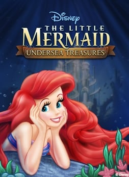

 

<h2>Game Summary</h2>

The Little Mermaid: Undersea Treasures is a Hidden Object Game developed for Windows 8 desktops and mobile devices. Along the same lines as Hitpoint’s other Disney title "Disney Fairies: Hidden Treasures", Little Mermaid features a full episodic story mode as well as various mini games to go along with the hidden object gameplay.

Little Mermaid: Undersea Treasures was published by Microsoft as a Windows 8 exclusive. Once Microsoft started pivoting
away from Windows 8 apps to their new Windows 10 apps, they decided to Cancel Little Mermaid: Undersea Treasures.

<h2>My Part</h2>

I was responsible for completing a wide variety of gameplay scripting tasks for The Little Mermaid: Undersea Treasures using Hitpoint’s C# engine.

- Setup scenes and placed objects based off of designer’s specifications.
- Scripted story event sequences.
- Worked with designers and artists to build puzzle based mini-games.

